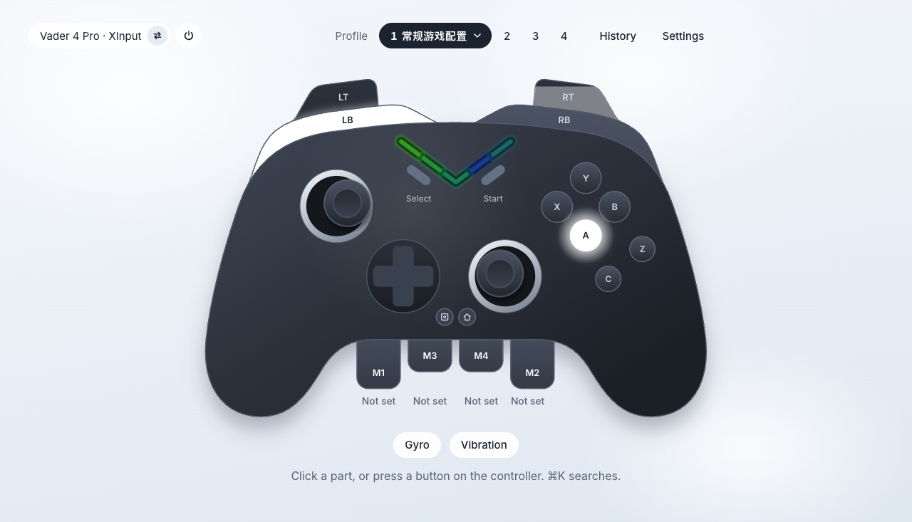
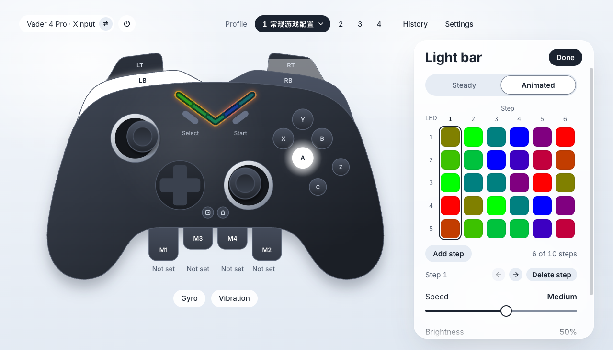
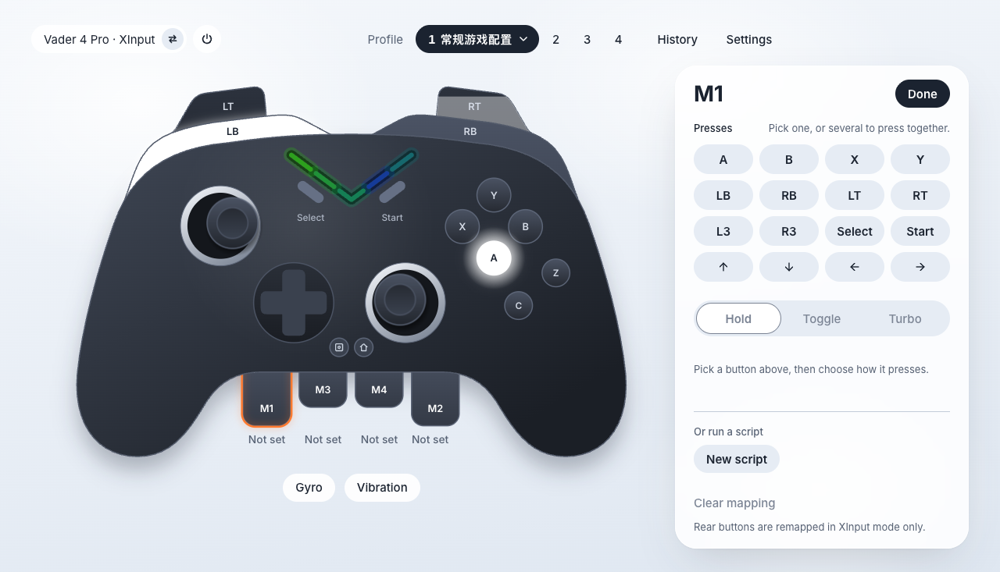
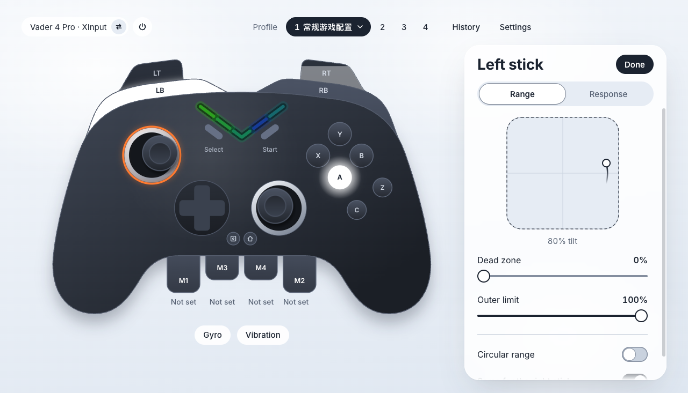
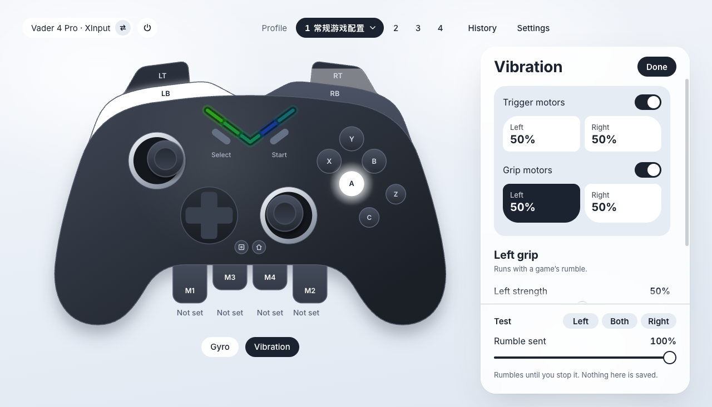

# VaderDaddy


Settings for the Flydigi Vader 4 Pro on macOS, wirelessly through the 2.4G dongle: lighting (steady and animated),
button remaps, deadzones, gyro, vibration, sleep timeout, backups. Flydigi's own app doesn't run on a Mac.



| | |
|---|---|
|  |  |
|  |  |

## Tested with

| | |
|---|---|
| Controller | Flydigi Vader 4 Pro, firmware 6.9.3.3 |
| Dongle | the 2.4G dongle it ships with, firmware 86.4, in XInput and DInput mode |
| Cable | USB-C |
| Mac | Apple silicon, macOS 27 |

That is one controller on one Mac. Other firmware versions and Intel Macs may work but have not been tried.
Any controller that is not a Vader 4 Pro is refused: nothing is read from it or written to it.

**No warranty.** VaderDaddy is not made by or affiliated with Flydigi. It was worked out by observing the
controller, and it writes settings to it. The app takes a backup before every save (History), but if it damages
or bricks a controller, that is at your own risk. See [LICENSE](LICENSE).

## Install

Needs macOS 13 or later, the Xcode command line tools (`xcode-select --install`), [Homebrew](https://brew.sh)
and Node.js (`brew install node`).

1. Download `VaderDaddy-0.1.zip` from the [latest release](https://github.com/PlaintextPirate/vader-daddy/releases/latest) and unzip it somewhere it can stay (not Downloads).
2. In Terminal, go into the unzipped folder and run the installer:

```bash
cd ~/VaderDaddy-0.1        # wherever you put it
./install.sh
```

It installs the USB library, builds the app into Applications, installs the wireless helper (this step asks for
your Mac password) and opens VaderDaddy. `./install.sh --no-helper` skips the helper: the app then works over
the USB-C cable and the dongle in DInput mode, and needs no password.

Keep the folder where it is afterwards: the app runs from it. Run `./install.sh` again after moving or updating
it. For the `vader` command in a terminal: `ln -sf "$PWD/bin/vader" /usr/local/bin/vader` (or anywhere on your
PATH).

## Use

Open VaderDaddy, or from a terminal:

```bash
vader status
vader lighting orange -b 15
vader deadzone left 5
vader remap m1 a
vader sleep 30
vader backup
vader restore latest
```

Connections: dongle in XInput mode (everything, via the helper), cable (everything, no helper), dongle in DInput
mode (profiles save, lighting doesn't persist).

`./uninstall.sh` removes the app and the helper.

## What is in this folder

| Path | What it is |
|---|---|
| `helper/` | Root background service that talks to the dongle in XInput mode (macOS's Xbox driver has to be detached, which needs root). Installed once. |
| `vader/` | Python core: connection backends, lighting and profile encoders, the `vader` command, the local service behind the app. |
| `ui/` | The app's interface (SvelteKit), served by `vader serve`. |
| `app/` | `VaderDaddy.app`: a native window around that interface. |
| `bin/vader` | Launcher for the command-line tool. |
| `research/` | One-off probes and reverse-engineering scripts from getting here. Not used by the app. |

## Licence

MIT: use it, change it and share it, keeping the copyright notice. No warranty of any kind.
